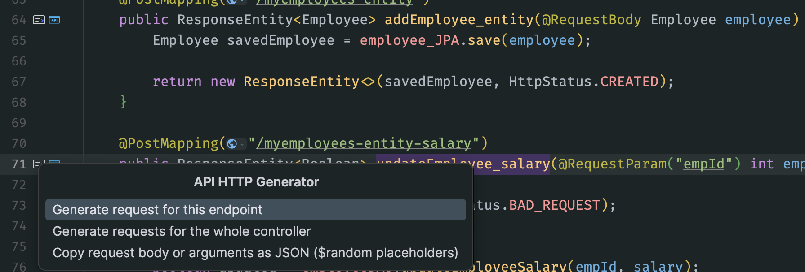
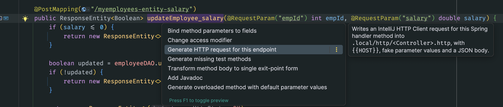
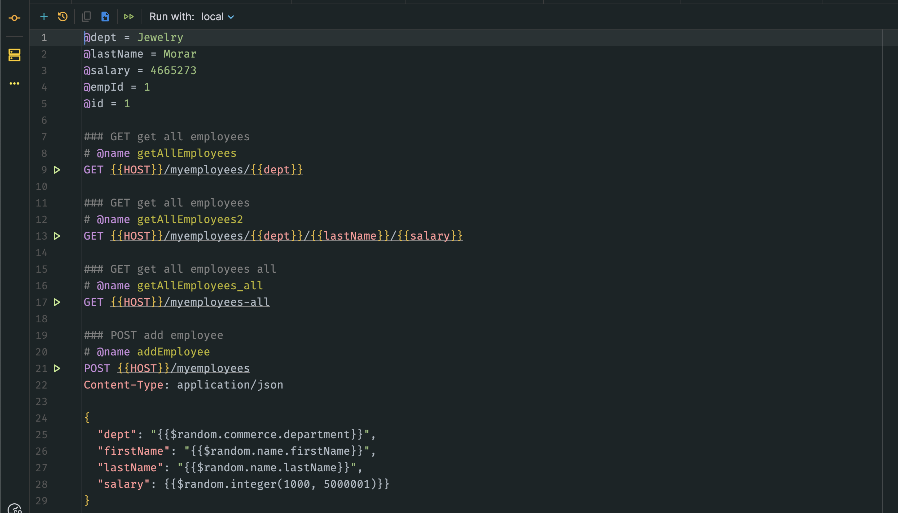
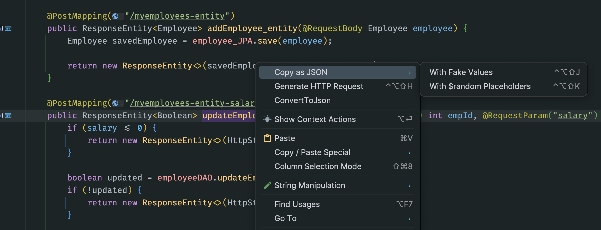

# API HTTP Generator

A JetBrains IDE plugin that writes IntelliJ HTTP Client requests for you, so you can test endpoints without leaving the IDE.

- **REST**: `{{HOST}}`-based requests for a Spring MVC handler method or a whole controller.
- **GraphQL (SPQR)**: `GRAPHQL` requests for `@GraphQLQuery` and `@GraphQLMutation` resolvers, with a login request, typed operation variables and a selection set. IntelliJ itself cannot generate these.
- **Copy as JSON**: a class, a field, a parameter or a method's parameters as JSON with realistic fake values, either fixed or as `{{$random...}}` placeholders.

Generated requests go to `.local/http/<Class>.http` in the module, which keeps them out of git when `.local/` is ignored.

---

## 1. Install

1. Get `api-http-generator-<version>.zip` (from a release, or build it, section 8).
2. In IntelliJ IDEA: **Settings > Plugins > gear icon > Install Plugin from Disk**, pick the zip.
3. Restart the IDE when asked.

Needs IntelliJ IDEA 2025.1 or later with the Java plugin (bundled).

---

## 2. Generate requests

Three ways to start, all doing the same thing:

| Where | What to do | Result |
|---|---|---|
| Gutter icon next to a handler or resolver | Click it, pick from the menu | This endpoint, the whole class, or copy its body as JSON |
| Alt+Enter on a method signature | "Generate HTTP request for this endpoint" | That endpoint |
| Alt+Enter on the class name | "Generate HTTP requests for this controller" | Every endpoint in the class |
| Right-click in the editor | **Generate HTTP Request** (top of the menu) | The method at the caret, or the whole class |
| Ctrl+Alt+Shift+H | Same as the menu entry | Same as the menu entry |





The file opens at the first new request. Running it again only appends endpoints the file does not have yet: requests you edited are left alone.

### 2.1 What a REST file looks like



- **`### <METHOD> <title>`** and **`# @name <methodName>`** on every request, so each one is listed in the Services tool window. Overloaded methods get `name2`, `name3`.
- **Path variables and id parameters** become file variables at the top (`@id = 1`, `@empId = 1`). Point them at a real record once; nothing that updates or deletes ever gets a random id.
- **`@RequestParam`**: in the query string on GET, in an `application/x-www-form-urlencoded` body otherwise. `@RequestHeader` becomes a header. A `Pageable` parameter adds `page=0&size=20`.
- **`@RequestBody`**: JSON with `{{$random...}}` placeholders, so every run sends fresh data. Server-generated fields (`@GeneratedValue`) are left out.
- **Not sent**: servlet request/response, principal, model, binding result and similar framework arguments.

### 2.2 What a GraphQL (SPQR) file looks like

For a resolver such as:

```java
@GraphQLApi
public class DepartmentResolver {
    @GraphQLQuery(name = "departments")
    public ApiResponse<Paged<DepartmentView>> list(@GraphQLArgument(name = "search") SearchRequest search) { ... }
}
```

the generated file starts with:

```http
### POST login (run first; the token lasts until it expires)
# @name login
POST {{AUTH_URL}}
Authorization: Basic {{CLIENT_ID}} {{CLIENT_SECRET}}
Content-Type: application/x-www-form-urlencoded

grant_type={{GRANT_TYPE}}&
username={{USERNAME}}&
password={{PASSWORD}}

> 

### GRAPHQL departments
# @name departments
GRAPHQL {{HOST}}/graphql
Authorization: Bearer {{access_token}}

query Departments($search: SearchRequestInput!) {
  departments(search: $search) {
    success
    code
    message
    data {
      items {
        uid
        name
        code
      }
      total
    }
  }
}

{
  "search": {
    "paging": {
      "page": 0,
      "pageSize": 10
    }
  }
}
```

- **A `login` request first.** It posts to `{{AUTH_URL}}` with client credentials and a username/password, and stores `access_token`; every `GRAPHQL` request sends `Authorization: Bearer {{access_token}}`. Run it once, then the rest. The grant type and every value come from the env files, so it fits any OAuth2 password-style login.
- **Names follow SPQR**: the operation name is the `name` of `@GraphQLQuery`/`@GraphQLMutation`, arguments are named by `@GraphQLArgument`, input types get an `Input` suffix (`SearchRequestInput`), scalars use SPQR's names (`UUID`, `Long`, `LocalDate`).
- **Variables** carry the arguments as JSON. An argument named like an id (`uid`, `id`, `...Id`) becomes a file variable.
- **The selection set** goes three levels deep and asks only for what SPQR exposes: public getters (including computed ones such as `getCode()`), public fields and Lombok getters. Spring Data `Page<T>` is selected as an object (`content { ... } totalElements ...`).
- **The endpoint** comes from `graphql.spqr.http.endpoint` (default `/graphql`).

### 2.3 Environment files

Created next to the request files on first use, never overwritten (missing keys are added):

| File | Keys | Commit? |
|---|---|---|
| `http-client.env.json` | `HOST` (from `server.port` and `server.servlet.context-path`), and for GraphQL `AUTH_URL`, `GRANT_TYPE`, `CLIENT_ID`, `USERNAME` | They live in `.local/`, so no |
| `http-client.private.env.json` | `CLIENT_SECRET`, `PASSWORD` (GraphQL only) | Never |

Pick **local** in the **Run with** list at the top of the `.http` file, or `{{HOST}}` stays unresolved.

---

## 3. Copy as JSON



Right-click, **Copy as JSON**, then:

- **With Fake Values** (Ctrl+Alt+Shift+J): fixed values, valid JSON that pastes anywhere (Swagger, tests, another client).
- **With $random Placeholders** (Ctrl+Alt+Shift+K): `{{$random...}}` where the HTTP Client has a generator, for `.http` files.

What gets copied depends on the caret:

| Caret on | Copied |
|---|---|
| A class name, or a project type such as `Employee` in `add(Employee e)` | The whole class |
| A field or parameter of a simple type | `{"name": value}` (using the `@RequestParam`/`@GraphQLArgument` name) |
| A method name, or inside its body | Its `@RequestBody` class, else all its parameters |
| An injected interface (a DAO or service) | Nothing; a notice says why |

---

## 4. Fake values

Each value is chosen in this order: validation constraints, then the field name, then the Java type.

### 4.1 Validation constraints (jakarta and javax)

| Constraint | Value |
|---|---|
| `@Pattern(regexp)` | A string matching the expression (fixed, generated with Datafaker) |
| `@Email` | `{{$random.internet.emailAddress}}` |
| `@Size(min, max)` on a string | The name hint when its values fit, else `{{$random.alphabetic(n)}}` of a fitting length |
| `@Min`, `@Max`, `@DecimalMin`, `@DecimalMax`, `@Positive`, `@PositiveOrZero`, `@Negative` | A number in that range |
| `@Past`, `@PastOrPresent`, `@Future`, `@FutureOrPresent` on dates | A date up to two years back or ahead |

### 4.2 Field names

Matched ignoring case and underscores (`first_name` = `firstName`). When the whole name matches nothing, its last words are tried (`customerEmail` uses `email`).

| Field names | Placeholder | Example |
|---|---|---|
| email, mail | `{{$random.internet.emailAddress}}` | `shonta.ebert@hotmail.com` |
| firstName, givenName, middleName | `{{$random.name.firstName}}` | `Felice` |
| lastName, surname | `{{$random.name.lastName}}` | `Boyle` |
| fullName, displayName, contactPerson | `{{$random.name.fullName}}` | `Caren Connelly` |
| name | depends on the class: company, department, product, university, city, country, course, role title, a person's full name, else a word | `Crona and Sons` |
| username, login | `{{$random.name.username}}` | `adriane.durgan` |
| password, confirmPassword, newPassword (and similar) | fixed `Str0ng!Passw0rd` so a confirmation always matches | `Str0ng!Passw0rd` |
| phone, mobile, msisdn | `{{$random.phoneNumber.cellPhone}}` | `1-381-318-6919` |
| url, website | `{{$random.internet.url}}` | `www.enedina-bashirian.co` |
| image, logo, avatar, photo | `{{$random.internet.image}}` | an image URL |
| city, town, district | `{{$random.address.city}}` | `Waelchifurt` |
| street, addressLine | `{{$random.address.streetAddress}}` | `71034 McLaughlin Station` |
| address, location | `{{$random.address.fullAddress}}` | full address |
| zip, postalCode | `{{$random.address.zipCode}}` | `52775` |
| country / countryCode | `{{$random.address.country}}` / `countryCode` | `Marshall Islands` / `KM` |
| region, state, province | `{{$random.address.state}}` | `Nebraska` |
| latitude, longitude | `{{$random.address.latitude}}` / `longitude` | `61.065168` |
| company, organization, institution, vendor | `{{$random.company.name}}` | `Grady-Glover` |
| department, dept | `{{$random.commerce.department}}` | `Tools` |
| industry, profession | `{{$random.company.industry}}` / `profession` | `Ranching` |
| title, jobTitle, designation, position, role | `{{$random.name.title}}` | `Chief Integration Executive` |
| product, item | `{{$random.commerce.productName}}` | `Fantastic Aluminum Shoes` |
| description, notes, comment, remarks, reason | `{{$random.lorem.sentence}}` | a sentence |
| message, body, content, text | `{{$random.lorem.paragraph}}` | a paragraph |
| tag, keyword, label | `{{$random.lorem.word}}` | `consectetur` |
| color | `{{$random.color.name}}` | `azure` |
| university, school / course | `{{$random.university.name}}` / `educator.course` | `Western Oklahoma Academy` |
| iban, accountNumber / bic, swift | `{{$random.finance.iban}}` / `bic` | `KW94QDEH...` |
| isbn | `{{$random.code.isbn13}}` | `9780740943171` |
| nida, nationalId, idNumber | `{{$random.idNumber.valid}}` | `696-22-1614` |
| uid, uuid, guid (string) | `{{$uuid}}` | a UUID |
| code, shortCode, reference, controlNumber | `{{$random.alphanumeric(8)}}` | `W5L6CRDG` |
| token, secret, apiKey, hash | `{{$random.alphanumeric(32)}}` | 32 characters |
| currency | one of `TZS`, `USD`, `EUR`, `KES` | `TZS` |
| gender, sex | one of `MALE`, `FEMALE` | `MALE` |
| salary, amount, price, cost, fee, balance, total, budget | `{{$random.integer(1000, 5000001)}}` or `float` | `3159494` |
| age / year / month | `integer(18, 66)` / `integer(2020, 2031)` / `integer(1, 13)` | `34` |
| quantity, count, number, stock, size | `{{$random.integer(1, 101)}}` | `42` |
| percent, rate, score | `integer(0, 101)` or `float(0, 100)` | `57` |
| first, offset, page | `0` (the first page) | `0` |
| pageSize, limit | `10` | `10` |
| sortBy, orderBy | `null` (a made-up property is rejected) | `null` |
| sortDirection, direction, order | one of `ASC`, `DESC` | `DESC` |

### 4.3 Java types (when no name matches)

| Type | Value |
|---|---|
| `String` | `{{$random.lorem.word}}` |
| `int`, `long`, `Integer`, `Long`, `BigInteger` | `{{$random.integer(1, 1001)}}` |
| `double`, `float`, `BigDecimal` | `{{$random.float(1, 1000)}}` |
| `boolean` | `true` or `false` (fixed) |
| `UUID` | `{{$uuid}}` |
| `LocalDate`, `LocalDateTime`, `LocalTime` | a fixed ISO value near today |
| `Instant`, `OffsetDateTime`, `ZonedDateTime`, `Date` | `{{$isoTimestamp}}` |
| enum | one of its constants (fixed) |
| `byte[]` | a Base64 string |
| `List`, `Set`, arrays | one element |
| `Map` | `{"key": value}` |
| a class | its fields, three levels deep; a class already being walked becomes `{}` |

### 4.4 Rules that keep requests valid

- **Own ids are `null` inside request payloads** (`id`, `uid`, `uuid` of the DTO itself): the server generates them or uses them to find the record. References to other records (`institutionUid`) keep a fake value.
- **Search and filter lists are empty** (`searchFields`, `filters`, `criteria`): a made-up criterion names a field the server does not allow.
- **Fixed values in placeholder mode**: dates, booleans, enums, patterns and the fixed lists above. The HTTP Client has no generator for them (`date.*`, `bool.*`, `job.*` and any Faker method with arguments are sent as literal text, checked with IntelliJ 2026.2).

---

## 5. Keyboard shortcuts

| Action | Default |
|---|---|
| Generate HTTP Request | Ctrl+Alt+Shift+H |
| Copy as JSON: With Fake Values | Ctrl+Alt+Shift+J |
| Copy as JSON: With $random Placeholders | Ctrl+Alt+Shift+K |

They are deliberately unusual so they clash with nothing. Rebind them in **Settings > Keymap** (search "API HTTP Generator" or the action name).

---

## 6. Limits

- Java only (Kotlin controllers are not read yet).
- Schema-first GraphQL is not covered; SPQR (code first) is.
- The login request assumes a token endpoint that returns `access_token`; adjust the request once if your backend differs.
- Reference ids (`institutionUid`) are fake and usually need a real value before a create succeeds.

---

## 7. Troubleshooting

| Symptom | Fix |
|---|---|
| `{{HOST}}` underlined | Pick **local** in **Run with** |
| GraphQL returns `401` | Run the `login` request first, or again after the token expires |
| GraphQL returns 200 with `errors` | Read `errors[0].message`; a field the server does not expose or a wrong variable type |
| Update or delete answers "not found" | Set the `@id` / `@uid` file variable to a real record |
| A request was not regenerated | Requests already in the file are kept as edited; delete it there to get a fresh one |

---

## 8. Build

Needs JDK 21.

```bash
./gradlew test buildPlugin
```

The zip lands in `build/distributions/`. Tests run headless in IntelliJ's test framework.

## 9. Compatibility

IntelliJ IDEA (Ultimate or Community) build 251 (2025.1) or later, no upper bound. Compiled against IntelliJ IDEA 2026.2.
